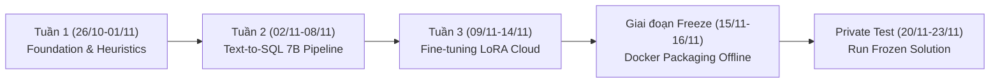

# Kế hoạch Triển khai Chi tiết — Zalo AI Challenge 2026 (Track 2: DataMate)

## Cập nhật thực tế ngày 01/11/2026 — đọc trước lịch trình gốc

Phần này cập nhật ưu tiên theo mã nguồn và ROADMAP hiện tại; lịch trình phía dưới được giữ làm lịch sử, không phải báo cáo trạng thái mới nhất. Các nhận định cũ về model “số 1”, SFT chắc chắn vượt zero-shot, KPI điểm số và tốc độ là giả thuyết/mục tiêu, chưa phải kết quả đã kiểm chứng.

### Baseline và hiện trạng đã đối chiếu

- Baseline đã nộp: **v2.8, Public PA 0.13400**, theo người dùng và ROADMAP (lần nộp 12). Không có đáp án Public để xác định câu sai cụ thể.
- Git `HEAD` tại thời điểm rà soát là `874f9bd`; bản `submission.jsonl` trong HEAD có 1.000 dòng: 182 number, 19 percent, 3 unanswerable, 796 abstain. SHA256: `288ed868fde9175d36afd8995cdaf0e2c5f978a716be5c2a845f35c5e89afb9f`. Cơ cấu khớp mô tả v2.8; chưa có checksum của file trên portal để chứng minh đồng nhất từng byte.
- **File working tree hiện chỉ có 5 dòng**, là thay đổi chưa commit. Không coi file này là artifact đủ 1.000 câu đã đạt 0.13400. Script xuất bài cho phép `--limit` cùng output mặc định `submission.jsonl`, có nguy cơ ghi đè bản đầy đủ khi chạy thử. Chưa xác minh nguyên nhân lần ghi đè hiện tại.
- Hybrid đã có `HybridAgent`, prompt generator, API client, Slow Path và notebook Colab. Slow Path mặc định tắt. Theo ROADMAP, LoRA đã train/merge trên Colab; benchmark 30 câu ghi Fast Path 8 đúng, Slow Path 2 đúng/5 sai, 15 abstain. Chưa xác minh lại endpoint hoặc checkpoint cloud trong lần rà soát này.
- `train_sft.jsonl` hiện có 761 mẫu của 30 doanh nghiệp: 615 number, 126 percent, 20 unanswerable. Dữ liệu đào từ Fast Path không tự tạo giám sát cho toàn bộ long-tail; loss thấp chưa chứng minh độ chính xác nghiệp vụ hay khả năng khái quát hóa.

### Thứ tự công việc đề xuất và tiêu chí nghiệm thu

1. **Bảo vệ artifact nộp bài.** Lưu bản chạy thử riêng; chỉ xuất `submission.jsonl` chính thức sau khi kiểm tra đầy đủ ID duy nhất, số câu, kiểu và giá trị JSON. Không tự ghi đè thay đổi hiện có. Việc phục hồi bản HEAD không đồng nghĩa tái xác nhận score portal.
2. **Chuẩn hóa evaluator trước khi dùng điểm để ra quyết định.** Rulebook §9 yêu cầu đúng type/format và khớp số; các evaluator hiện cho phép sai lệch số và/hoặc nhân phần trăm với 100. Cần bộ chấm dùng chung có kiểm thử chống chấp nhận sai type, sai đơn vị phần trăm, sai số tiền, thứ tự list và cấu trúc table. Tính lại baseline sau khi sửa.
3. **Thiết lập đánh giá giữ riêng doanh nghiệp.** `benchmark_lbo.py` hiện chỉ phân nhóm doanh nghiệp để chạy cùng resolver, không có bước fit/tune tách biệt theo fold. Vì vậy 99.87% là số liệu đánh giá Train theo nhóm với evaluator hiện tại, chưa đủ chứng minh precision trên doanh nghiệp unseen. Chốt tập train/dev theo business trước khi tinh chỉnh prompt, gate hoặc SFT; giữ ID và provenance mẫu để kiểm tra trùng lặp.
4. **Kiểm chứng Slow Path theo nhóm nghiệp vụ.** So sánh Fast-only với Hybrid trên tập giữ riêng; báo cáo correct/wrong/abstain, PA và mức tăng PA của Slow Path. Confidence do model tự khai không phải xác suất đã hiệu chuẩn. Các ca doanh thu ngày đúng trong mẫu nhỏ mới là giả thuyết cho selective gate; chỉ bật khi có bằng chứng bổ sung. Gate lỗi SQL/NULL không chứng minh SQL đúng ngữ nghĩa.
5. **Củng cố thực thi và khả năng tái lập.** `engine.execute_query` hiện thực thi SQL trực tiếp trên connection, chưa có bằng chứng cô lập an toàn; cần giới hạn SQL đọc dữ liệu, tài nguyên và quyền truy cập bên ngoài trước khi xem là sandbox. Rà hợp đồng JSON, kết quả scalar nhiều dòng, số không hữu hạn, boolean và kiểm định lại response sau self-correction.
6. **Chuẩn bị offline trước hạn 16/11.** Hoàn thiện Dockerfile, entrypoint, dependencies/model revisions và log từng câu. Kiểm tra `/data:ro`, `--network none`, hai lần chạy tái lập và thời gian thực thi. Các notebook cloud cài package không pin chưa thay thế quy trình freeze tái lập.

Nguồn nghiệp vụ ưu tiên: `data/<split>/<split>/rulebook.md` và README từng shop; thể lệ chung đọc từ `zalo-ai-challenge-regulations-en.pdf`, hướng dẫn tổng hợp ở `ZAIC_2026_GUIDE.md`. Ví dụ rulebook đã định nghĩa tháng/quý không ghi năm, không nên gọi mặc định này là phỏng đoán 50/50. Những thông số kỹ thuật chỉ có trong guide/portal cần xác minh riêng trước freeze.

---

> **Mục tiêu:** Xây dựng Data Agent vô địch bảng đấu DataMate (Zalo AI Challenge 2026), tối đa hóa điểm số **Penalized Accuracy (PA)**, tuân thủ 100% các quy định kỹ thuật về Docker offline, giới hạn tham số $\le 15B$, và hoàn thành trước thời hạn đóng băng giải pháp (**23:59 ngày 16/11/2026**).

---

## 🏛️ I. Nhận định Chiến lược Cuối cùng (Cốt lõi Định hướng)

> [!IMPORTANT]
> **3 Nguyên tắc Bất biến đã được chốt:**
> 1. **Về nền tảng gốc:** Dòng họ mô hình **`Qwen2.5-Coder`** chắc chắn là lựa chọn số 1 thế giới hiện nay cho bài toán Code Generation & Text-to-SQL dưới 15B tham số (vượt trội hoàn toàn so với Llama, DeepSeek hay TableGPT trong việc hiểu câu hỏi tiếng Việt và cú pháp SQL phức tạp).
> 2. **Về kích thước & Bản chất thi đấu:** Bản 14B có trần năng lực tư duy cao nhất. **Tuy nhiên, một mô hình 7B được Fine-tune (SFT) trên 3.000 câu hỏi kèm luật `rulebook.md` của tập Train sẽ đè bẹp hoàn toàn một mô hình 14B chạy chay (zero-shot)!**
> 3. **Lộ trình phân tầng phần cứng khôn ngoan:**
>    * **Giai đoạn 1 (Tại máy cá nhân — AMD Ryzen 7 5700X 8C/16T, 32GB RAM DDR4 3200MHz, RX 6600 8GB, NVMe SSD dồi dào):** Sử dụng CPU 8 nhân 16 luồng và 32GB RAM kết hợp bộ ba `openpyxl + pandas + duckdb` để hoàn thiện 100% pipeline dọn rác, schema linking, luật thời gian và prompt templates. Máy nhà xử lý dữ liệu bảng cực nhanh trong RAM mà không tốn VRAM hay điểm điện toán.
>    * **Giai đoạn 2 & 3 (Tại Google Colab Pro — Gói Google AI Plan có sẵn 200 Compute Units, GPU A100/L4):** Sử dụng trực tiếp GPU A100 (40GB/80GB) hoặc L4 (24GB) có sẵn trong gói Colab Pro của bạn để chạy suy luận vLLM và train LoRA cho cả bản 7B và bản 14B trên 3.000 cặp câu hỏi - đáp án của tập Train (0đ chi phí phát sinh). Đánh giá đối đầu và chọn ra checkpoint có điểm Penalized Accuracy cao nhất để đóng gói Docker nộp cho BTC.

---

## 📅 II. Lịch trình Triển khai Chi tiết Từng Ngày (26/10 – 23/11/2026)

Lịch trình được thiết kế chuẩn xác bám sát timeline chính thức của BTC:



---

### GIAI ĐOẠN 1: NỀN MÓNG DỮ LIỆU & ENGINE ĐỊNH LUẬT (26/10 – 01/11)
*Mục tiêu: Làm chủ toàn bộ cấu trúc dữ liệu, bẻ khóa Excel/SQLite, và xây dựng bộ lọc thời gian/luật nghiệp vụ deterministic.*

#### Ngày 1 (26/10): Khởi tạo Môi trường & Thiết lập Hiến pháp Dự án *(ĐÃ HOÀN THÀNH)*
- [x] Khởi tạo môi trường ảo `uv` với Python 3.14, cài đặt `duckdb`, `pandas`, `polars`, `openpyxl`, `python-calamine`, `pyarrow`, `rapidfuzz`.
- [x] Đóng gói skill chuyên dụng `duckdb-data-agent` và module cốt lõi `src/zaic_2026_datamate/`.
- [x] Giải nén và rà soát tập `train.zip` (3.000 câu) và `public_test.zip` (1.000 câu).
- [x] Cập nhật toàn diện [AGENTS.md](file:///home/pt/AI%20Challenge/AGENTS.md) và [ZAIC_2026_GUIDE.md](file:///home/pt/AI%20Challenge/ZAIC_2026_GUIDE.md).

#### Ngày 2 (27/10): Xây dựng Bộ Parser Đa Nguồn (`data_loader.py`)
- [ ] Lập trình loader tự động quét thư mục `data/<business_id>/`.
- [ ] Hỗ trợ đồng thời 3 định dạng: `.xlsx` (unmerge bằng `openpyxl`), `.csv` (đọc bằng `pandas/calamine`), `.sqlite` (truy vấn trực tiếp bằng `duckdb.attach`).
- [ ] Đọc và phân tích file `README.md` của từng shop để trích xuất bảng quy đổi đơn vị (hệ số quy đổi thùng $\rightarrow$ lon/gói).
- [ ] Viết unit test cho 5 shop đại diện (Tạp hóa, Nhà thuốc, Cà phê, Vật liệu xây dựng, Nhà xe).

#### Ngày 3 (28/10): Module Điểm neo Thời gian & Lịch Âm (`time_anchor.py`)
- [ ] Lập trình hàm phân giải mốc thời gian dựa trên `as_of_date`:
  - `"Hôm nay"`, `"Hôm qua"`.
  - `"Tuần này"` (Thứ 2 đến `as_of_date`), `"Tuần trước"` (trọn vẹn Thứ 2 đến Chủ nhật tuần trước).
  - `"Tháng này"` (Ngày 1 đến `as_of_date`), `"Tháng trước"` (cùng số ngày tương ứng tháng trước).
  - `"Từ đầu năm"` (01/01 đến `as_of_date`).
- [ ] Nạp `calendar.csv` vào DuckDB để xử lý các câu hỏi về **Mùa Tết** (từ 23 tháng Chạp đến hết mùng 10 tháng Giêng).
- [ ] Lọc bỏ toàn bộ các bản ghi sau `as_of_date` (coi như chưa xảy ra).

#### Ngày 4 (29/10): Mã hóa Luật Nghiệp vụ Cốt lõi (`rulebook_engine.py`)
- [ ] Cài đặt các quy tắc mặc định theo `rulebook.md`:
  - **Doanh thu:** Chỉ tính đơn `không huỷ` và `không trả hàng`. Nếu đơn có trả hàng một phần $\rightarrow$ bỏ toàn bộ đơn.
  - **Tiền hàng:** Bằng tổng thành tiền dòng hàng trừ chiết khấu dòng (không trừ voucher toàn đơn, không cộng VAT, không tính phí ship).
  - **Xếp hạng bán chạy:** Xếp theo **Số lượng quy về đơn vị cơ bản** (không xếp theo doanh thu tiền).
  - **Công nợ:** Không tính đơn COD và sàn TMĐT vào nợ.
- [ ] Viết bộ test assertion kiểm chứng các quy tắc trên với tập dữ liệu nhỏ.

#### Ngày 5 (30/10): Chuẩn hóa Định dạng Đầu ra 8 Loại (`formatter.py`)
- [ ] Xây dựng module ép kiểu nghiêm ngặt (Strict Output Formatting) theo đúng bảng quy chuẩn của BTC:
  - `number`: Số nguyên VND hoặc float làm tròn 2 chữ số (không kèm chữ cái hay ký hiệu).
  - `percent`: Float làm tròn 2 chữ số (không kèm ký hiệu `%`).
  - `date`: Chuẩn ISO `"YYYY-MM-DD"` hoặc `"YYYY-MM"`.
  - `list`: Mảng JSON có thứ tự `["mục 1", "mục 2"]`.
  - `string`: Giữ nguyên chính tả trong dữ liệu kèm dấu tiếng Việt.
  - `table`: Đúng cấu trúc `{"columns": [...], "rows": [[...]]}`.
  - `unanswerable`: `{"type": "unanswerable", "reason": "..."}`.
  - `abstain`: `{"type": "abstain"}`.

#### Ngày 6 (31/10): Chạy Đánh giá Offline Đầu tiên (Heuristic Baseline)
- [ ] Chạy thử nghiệm toàn bộ pipeline Heuristics/SQL templates trên 3.000 câu tập Train.
- [ ] Tính điểm **Penalized Accuracy (PA)** nội bộ:
  $$PA = \frac{1}{N} (\text{Số câu đúng} - \text{Số câu sai})$$
- [ ] Xuất báo cáo ma trận nhầm lẫn (Confusion Matrix): Các câu sai bị phạt tập trung ở nhóm câu hỏi nào?

#### Ngày 7 (01/11): Đóng gói & Nộp thử Nghiệm Public Leaderboard (Lượt 1)
- [ ] Chạy pipeline trên 1.000 câu của tập Public Test.
- [ ] Kiểm tra tính toàn vẹn của file `submission.jsonl` (đủ 1.000 dòng, đúng định dạng JSON Lines).
- [ ] Nộp bài lần đầu tiên lên portal để kiểm tra luồng nhận kết quả của BTC và ghi nhận điểm số baseline trên Public Leaderboard.

---

### GIAI ĐOẠN 2: TÍCH HỢP LLM & CỔNG KIỂM DUYỆT TỪ CHỐI (02/11 – 08/11)
*Mục tiêu: Dựng pipeline Text-to-SQL hoàn chỉnh với `Qwen2.5-Coder-7B-Instruct` chạy trên máy nhà RX 6600, tối ưu hóa Cổng từ chối kép.*

#### Ngày 8 (02/11): Triển khai Qwen2.5-Coder-7B Local Inference
- [ ] Cài đặt engine suy luận tối ưu cho AMD RX 6600 (dùng `llama.cpp` qua Vulkan hoặc `vLLM` ROCm).
- [ ] Tải weights `Qwen2.5-Coder-7B-Instruct` (phiên bản GGUF Q4_K_M hoặc Q5_K_M).
- [ ] Đo lường tốc độ suy luận: Đảm bảo thời gian sinh SQL đạt $\le 0.5$ giây / câu.

#### Ngày 9 (03/11): Hoàn thiện Bi-directional Schema Linking
- [ ] Nâng cấp [`schema_linker.py`](file:///home/pt/AI%20Challenge/src/zaic_2026_datamate/schema_linker.py):
  - Kết hợp DDL bảng + Danh sách cột liên quan + Gợi ý giá trị ô thực tế + 3 dòng dữ liệu mẫu (`df.head(3)`).
  - Tích hợp bảng quy đổi đơn vị từ `README.md` của từng shop vào ngữ cảnh.
- [ ] Giảm dung lượng prompt: Chỉ gửi đúng những cột có khả năng liên quan, giữ prompt gọn dưới 1.000 tokens.

#### Ngày 10 (04/11): Thiết kế System Prompt Chuyên biệt Hóa Tiếng Việt
- [ ] Biên soạn System Prompt nhúng toàn bộ các quy định bất biến của `rulebook.md` vào mô hình.
- [ ] Cung cấp 5 ví dụ mẫu (Few-shot Examples) giải quyết các ca khó:
  - Tính doanh thu loại trừ đơn huỷ/trả.
  - Xếp hạng bán chạy theo số lượng đơn vị cơ bản.
  - Tính tiền nhập hàng từ phiếu nhập.
  - Phân tích tăng giá $N$ ngày trước/sau.

#### Ngày 11 (05/11): Tinh chỉnh Cổng Kiểm duyệt kép (`strict-refusal-eval`)
- [ ] **Tối ưu Cổng 1 (`unanswerable` - Nhận +1 điểm):**
  - Xây dựng heuristic phát hiện câu hỏi ngoài phạm vi (ví dụ: hỏi lợi nhuận nhưng shop không có cột giá vốn/chi phí; hỏi ngày nằm hoàn toàn ngoài dữ liệu shop).
  - Nếu xác định chắc chắn dữ liệu thiếu $\rightarrow$ Xuất ngay `type: "unanswerable"`.
- [ ] **Tối ưu Cổng 2 (`abstain` - Nhận 0 điểm an toàn):**
  - Nếu SQL chạy lỗi qua 2 lượt retry $\rightarrow$ `abstain`.
  - Nếu câu trả lời dạng số âm bất hợp lý hoặc không tìm thấy bản ghi $\rightarrow$ `abstain`.

#### Ngày 12 (06/11): Benchmark & Nộp bài Public Leaderboard (Lượt 2)
- [ ] Chạy pipeline Qwen-7B trên tập Public Test.
- [ ] Ghi log chi tiết từng câu hỏi vào `logs/public_run_v1.log`.
- [ ] Nộp file `submission.jsonl` mới lên portal. So sánh điểm số với baseline ngày 01/11.

#### Ngày 13 (07/11): Phân tích Lỗi Chuyên sâu (Error Taxonomy)
- [ ] Lọc ra tất cả các câu trả lời sai trên 3.000 câu tập Train.
- [ ] Phân loại 4 nhóm lỗi phổ biến nhất:
  1. Lỗi lệch ngày do hiểu sai mốc `as_of_date`.
  2. Lỗi quên quy đổi đơn vị (thùng sang lon).
  3. Lỗi tính cả đơn bị huỷ/trả.
  4. Lỗi format sai kiểu dữ liệu.

#### Ngày 14 (08/11): Chuẩn bị Dữ liệu Huấn luyện SFT (Instruction Dataset)
- [ ] Chuyển đổi 3.000 cặp câu hỏi - đáp án của tập Train thành format hội thoại chuẩn ChatML của Qwen:
  ```json
  {
    "messages": [
      {"role": "system", "content": "You are DataMate, a professional Vietnamese Text-to-SQL data agent strictly following the competition rulebook..."},
      {"role": "user", "content": "Schema:\n...\nQuestion: tháng này tổng giá trị các phiếu nhập hàng là bao nhiu\nas_of_date: 2026-09-07"},
      {"role": "assistant", "content": "```sql\nSELECT COALESCE(SUM(tong_tien), 0) AS answer FROM phieu_nhap WHERE ngay_nhap >= '2026-09-01' AND ngay_nhap <= '2026-09-07' AND trang_thai != 'huỷ';\n```"}
    ]
  }
  ```
- [ ] Rà soát đảm bảo 100% dữ liệu huấn luyện sạch, không có nhãn sai lệch.

---

### GIAI ĐOẠN 3: HUẤN LUYỆN LORA TRÊN CLOUD GPU & BỨT PHÁ LEADERBOARD (09/11 – 14/11)
*Mục tiêu: Đưa tri thức `rulebook.md` vào trực tiếp trọng số mô hình bằng LoRA, nâng độ chính xác lên mức tối đa.*

#### Ngày 15 (09/11): Huấn luyện LoRA Qwen2.5-Coder-7B trên Google Colab Pro (GPU A100)
- [ ] Mở sổ tay huấn luyện Colab liên kết Google Drive, kích hoạt runtime **GPU A100 + RAM cao** (sử dụng 200 compute units có sẵn).
- [ ] Cài đặt thư viện huấn luyện SOTA (`unsloth` hoặc `trl` + `peft`).
- [ ] Cấu hình huấn luyện:
  - LoRA rank $r=16$, $\alpha=32$, target modules: `q_proj, k_proj, v_proj, o_proj, gate_proj, up_proj, down_proj`.
  - Batch size 16, learning rate $2 \times 10^{-4}$, cosine scheduler, 3 epochs.
  - Thời gian huấn luyện ước tính: **30–45 phút** (tiêu hao ~5–8 compute units).
- [ ] Lưu adapter weights trực tiếp vào Google Drive để tự động đồng bộ về máy.

#### Ngày 16 (10/11): Huấn luyện LoRA Qwen2.5-Coder-14B trên Google Colab Pro (GPU A100)
- [ ] Chạy tiếp quá trình huấn luyện LoRA cho bản **`Qwen2.5-Coder-14B-Instruct`** trên cùng tập dữ liệu 3.000 câu với GPU A100 (40GB/80GB).
- [ ] Áp dụng kỹ thuật QLoRA 4-bit (bitsandbytes) để tối ưu bộ nhớ và tốc độ.
- [ ] Thời gian huấn luyện ước tính: **1.5–2 giờ** (tiêu hao ~15–20 compute units).
- [ ] Lưu trữ và export model 14B LoRA hoàn chỉnh về Google Drive.

#### Ngày 17 (11/11): Đánh giá Đối đầu Toàn diện (Head-to-Head Evaluation)
- [ ] Chạy so sánh độc lập giữa 3 phiên bản:
  1. `Qwen2.5-Coder-7B Zero-shot` (bản gốc).
  2. `Qwen2.5-Coder-7B LoRA` (bản tinh chỉnh).
  3. `Qwen2.5-Coder-14B LoRA` (bản tinh chỉnh).
- [ ] Đánh giá 3 tiêu chí cốt lõi:
  * Điểm Penalized Accuracy trên tập Train validation.
  * Tốc độ suy luận (Inference time / question).
  * Kích thước mô hình khi đóng gói Docker.
- [ ] **Ra quyết định:** Lựa chọn checkpoint có điểm số thực chiến cao nhất và ổn định nhất.

#### Ngày 18 (12/11): Nộp bài Tối ưu lên Public Leaderboard (Lượt 3 & 4)
- [ ] Chạy suy luận với mô hình LoRA tốt nhất trên 1.000 câu Public Test.
- [ ] Nộp bài và theo dõi thứ hạng trên Public Leaderboard.
- [ ] Mục tiêu: Lọt vào Top 5 đội dẫn đầu bảng xếp hạng Public.

#### Ngày 19 (13/11): Tinh chỉnh Cận biên & Tối ưu Tốc độ (Margin Tuning)
- [ ] Kiểm tra lại ngưỡng tin cậy của Cổng từ chối: Điều chỉnh ngưỡng để chuyển dịch các câu "nguy hiểm dễ sai" sang `abstain` (bảo toàn 0 điểm thay vì mất -1 điểm).
- [ ] Tối ưu hóa truy vấn DuckDB: Thêm chỉ mục in-memory nếu bảng có kích thước lớn (>100.000 dòng).

#### Ngày 20 (14/11): Đóng băng Mã nguồn & Pipeline (Code Freeze)
- [ ] Tuyệt đối không viết thêm tính năng hay sửa logic lớn từ ngày này.
- [ ] Rà soát lại toàn bộ mã nguồn: Xóa các file rác, print debug thừa.
- [ ] Chạy `uv run pytest` đảm bảo toàn bộ unit test chạy xanh 100%.

---

### GIAI ĐOẠN 4: ĐÓNG GÓI DOCKER & THẨM ĐỊNH OFFLINE TRƯỚC HẠN FREEZE (15/11 – 16/11)
*Mục tiêu: Đóng gói Docker hoàn chỉnh, đáp ứng 100% luật kỹ thuật của BTC, nộp bài thành công trước 23:59 ngày 16/11.*

#### Ngày 21 (15/11): Xây dựng Dockerfile & Script Thực thi Chuẩn
- [ ] Viết `Dockerfile` theo đúng quy định BTC:
  - Base image: `nvidia/cuda:12.8.0-runtime-ubuntu22.04` (hỗ trợ kiến trúc GPU Blackwell RTX 5090).
  - Cài đặt Python, DuckDB, Pandas, vLLM hoặc Llama-cpp-python.
  - Copy toàn bộ source code `src/` và **weights mô hình đã huấn luyện** vào trong image (không tải gì khi chạy).
- [ ] Viết script `/predict.sh`:
  - Nhận input từ thư mục `/data` (được mount READ-ONLY).
  - Ghi output ra `/result/submission.jsonl`.
  - Ghi log từng câu ra `/result/logs/per_question_trace.log` (gồm ID, câu trả lời, thời gian chạy, câu SQL).
- [ ] Viết tài liệu `README.md` trong container khai báo chi tiết tên mô hình, số lượng tham số ($\le 15B$), cách thức chạy.

#### Ngày 22 (16/11): Thẩm định Offline & Nộp bài Freeze (HẠN CHÓT 23:59 GMT+7)
- [ ] **Chạy thử nghiệm mô phỏng môi trường của BTC:**
  ```bash
  docker run --rm \
    --network none \
    -v $(pwd)/data/public_test/public_test:/data:ro \
    -v $(pwd)/result_test:/result \
    datamate_submission:latest /predict.sh
  ```
- [ ] **Kiểm tra tính Tái lập (Reproducibility Check):**
  - Chạy liên tiếp 2 lần độc lập.
  - So sánh 2 file `submission.jsonl`: Đảm bảo trùng khớp **100%** ($|PA_1 - PA_2| = 0.00 \le 0.03$).
- [ ] **Xuất file Docker Package & Mã băm:**
  ```bash
  docker save datamate_submission:latest | gzip > datamate_submission.tar.gz
  sha256sum datamate_submission.tar.gz > checksum.txt
  ```
- [ ] Upload file `.tar.gz` lên Google Drive (mở quyền công khai cho BTC tải).
- [ ] Điền form **Solution Submission** trên cổng Zalo AI Challenge trước **23:59 ngày 16/11/2026**.
- [ ] **Chốt Danh sách Đội thi:** Bắt đầu từ ngày **17/11/2026**, BTC sẽ **khóa vĩnh viễn tính năng thêm/xóa thành viên** trong Team Management. Toàn bộ thông tin đội thi (tối đa 5 thành viên) phải hoàn tất trước thời điểm này.
- [ ] **Tuân thủ Bản quyền & Bảo mật (Mục 4.5 & Mục 10 Thể lệ):**
  - Kiểm tra toàn bộ mã nguồn đạt chuẩn OSI-approved (Apache 2.0 / MIT).
  - Không nhúng dữ liệu cá nhân nhạy cảm trái phép vào container.
  - Lưu email hỗ trợ chính thức của BTC: `aichallenge@zalo.me`.

---

### GIAI ĐOẠN 5: VÒNG PRIVATE TEST & KIỂM ĐỊNH CHUNG CUỘC (20/11 – 23/11)
*Mục tiêu: Thực thi giải pháp đã đóng băng trên tập Private Test, bảo toàn kết quả để tiến vào Chung kết.*

#### Ngày 23 (20/11): Tiếp nhận Private Test (09:00 GMT+7)
- [ ] BTC phát hành tập Private Test (~500 câu hỏi, xuất hiện các ngành hàng mới).
- [ ] Tải tập Private Test và nạp vào máy chạy.

#### Ngày 24 (21/11): Chạy Giải pháp Đã Đóng Băng
- [ ] Sử dụng đúng Docker image đã nộp ngày 16/11 để suy luận trên tập Private Test (không chỉnh sửa bất kỳ dòng code nào).
- [ ] Giám sát thời gian thực thi: Đảm bảo toàn bộ 500 câu hoàn thành dưới 6 tiếng (mục tiêu: dưới 30 phút).
- [ ] Kiểm tra định dạng file `submission.jsonl` đầu ra.

#### Ngày 25 (22/11): Nộp Kết quả Private Test & Rà soát Lần cuối
- [ ] Nộp file `submission.jsonl` lên cổng thi đấu trước thời hạn 23:59 ngày 23/11.
- [ ] Lưu trữ toàn bộ log `/result/logs/` để sẵn sàng đối chất kỹ thuật với BTC nếu có yêu cầu thẩm định.

#### Ngày 26 (02/12): Công bố Kết quả Chung cuộc & Bảo vệ Giải pháp
- [ ] BTC công bố Top 2 đội bước vào vòng bảo vệ và thẩm định trên server $2 \times$ RTX 5090.

---

## 🛡️ III. Ma trận Quản trị Rủi ro (Risk Mitigation Matrix)

| Nguy cơ rủi ro | Mức độ | Hậu quả | Giải pháp kỹ thuật phòng ngừa |
| :--- | :---: | :--- | :--- |
| **Bị trừ điểm nặng do trả lời bừa (-1 điểm)** | **Cực cao** | Điểm $PA$ bị âm, rớt hạng thảm hại | Luôn kích hoạt Cổng kiểm duyệt kép: Gặp dữ liệu thiếu $\rightarrow$ nộp `unanswerable` (+1 điểm); Không chắc chắn $\rightarrow$ nộp `abstain` (0 điểm). |
| **Lệch điểm tái lập $> 0.03$ khi BTC chạy lại** | **Chí mạng** | **Bị hủy kết quả thi (Disqualification)** | Khóa chặt `temperature = 0.0`, `seed = 42`. Ghi log chi tiết từng câu vào `/result/logs/` để giải trình. |
| **Lỗi ghi đè thư mục `/data`** | **Nghiêm trọng** | Crash container (Read-Only filesystem error) | Tuyệt đối cấu hình toàn bộ code ghi file trung gian vào `/tmp` hoặc `/result`. |
| **Crash do thiếu mạng (`--network none`)** | **Nghiêm trọng** | Script dừng giữa chừng | Đóng gói toàn bộ dependencies trong Docker, kiểm tra chạy thử với cờ `--network none` trước khi nộp. |
| **Vượt quá trần 15 tỷ tham số** | **Chí mạng** | Phạm quy, bị loại | Tuyệt đối không dùng mô hình MoE vượt 15B (như DeepSeek-Coder 16B). Chỉ dùng Qwen 7B hoặc 14B. |

---

## 🎯 IV. Bảng Đo lường Chỉ số Thành công (KPI Dashboard)

| Cột mốc | Ngày mục tiêu | Chỉ số đo lường (KPI) | Trạng thái |
| :--- | :---: | :--- | :---: |
| **M1: Môi trường & Core Modules** | 26/10/2026 | Unit tests pass 100%, load được 3 loại file | **ĐÃ ĐẠT** |
| **M2: Heuristic Baseline** | 01/11/2026 | Lần đầu nộp Public Test hợp lệ, PA > 0.40 | Sắp tới |
| **M3: Qwen 7B Local Pipeline** | 06/11/2026 | Chạy mượt trên RX 6600, PA Public > 0.60 | Sắp tới |
| **M4: Fine-tuned LoRA Model** | 12/11/2026 | Top 5 Public Leaderboard, PA Public > 0.75 | Sắp tới |
| **M5: Freeze Solution Docker** | 16/11/2026 | Docker offline chạy 100% tái lập, nộp trước 23:59 | Sắp tới |
| **M6: Private Test Submission** | 23/11/2026 | Nộp file private test đúng hạn, bảo toàn điểm số | Sắp tới |

## Trạng thái selective gate sau triển khai (01/11/2026)

Snapshot baseline, output atomic không ghi đè mặc định, evaluator dùng chung, gate doanh thu một ngày và audit split/provenance đã triển khai. Báo cáo Train nghiêm ngặt: 756 đúng / 6 sai / 2.238 abstain, PA 0.25000. Snapshot giữ score Public đã báo 0.13400; chưa nộp Public mới.

Checkpoint cũ chứa cả 30 doanh nghiệp Train. Thử endpoint Colab trên 7 câu eligible đều gặp HTTP 530 / Cloudflare 1033; chưa có kết quả chất lượng Slow Path. Giữ mặc định tắt. Bước tiếp theo là sửa kết nối để thăm dò, sau đó đào SFT chỉ từ train partition và train checkpoint mới trước đánh giá theo split đã chốt. Chi tiết bằng chứng và hạn chế ở ROADMAP và `docs/specs/2026-11-01-selective-slow-path.md`.

## Chuẩn bị checkpoint business24 (02/11/2026)

Đã đào 633 mẫu SFT từ 24 business (512 number, 106 percent, 15 unanswerable), overlap validation bằng 0. Tokenizer audit phát hiện nguy cơ truncation ở cấu hình 2.048 token cũ; mẫu mới dài tối đa 5.292 nên notebook mới dùng trần 8.192, kiểm toàn bộ length trước train và completion-only loss.

Chạy `notebooks/03_business_holdout_training.ipynb` với `artifacts/zaic-business24-training.zip` trong tab Colab A100; runtime hiện tại không attach được từ CLI. Chưa train hoặc tạo checkpoint mới. Sau train: lấy `training_manifest.json`, xác minh data hash/revision, phục vụ adapter mới trên endpoint mới, đánh giá split 6 business bằng `--training-data artifacts/train-only-sft.jsonl`. Ranh giới này chỉ kiểm soát SFT; lịch sử tune rule/prompt chưa được giữ riêng.

## Revenue metric guard đã triển khai (02/11/2026)

Slow Path doanh thu ngày kiểm lineage SQL bằng DuckDB AST và đối chiếu định nghĩa cột trong README đúng file/bảng trước execute. Chỉ nhận direct SUM(column), tùy chọn ROUND, với mô tả tiền hàng được hỗ trợ; thiếu/mâu thuẫn/SQL ngoài phạm vi → abstain. Không tự sửa SQL hay dùng ground truth để chọn cột. Fast Path, prompt và checkpoint không đổi.

Replay và live development evaluation đều giữ 5 câu đúng, chặn 2 câu sai metric: Hybrid PA 0.2673684 trên 475 câu (128 đúng / 1 sai / 346 abstain), so với 0.2631579 trước guard. Những lỗi này đã được xem khi thiết kế, nên kết quả là regression/development evidence, không phải untouched validation. Guard chỉ kiểm metric, chưa xác minh toàn bộ WHERE/date/status/table choice; README parser có phạm vi mô tả hữu hạn, unknown sẽ từ chối. Slow Path vẫn mặc định tắt và chưa khuyến nghị bật Public. Thiết kế/phạm vi: `docs/specs/2026-11-02-revenue-metric-guard.md`.
