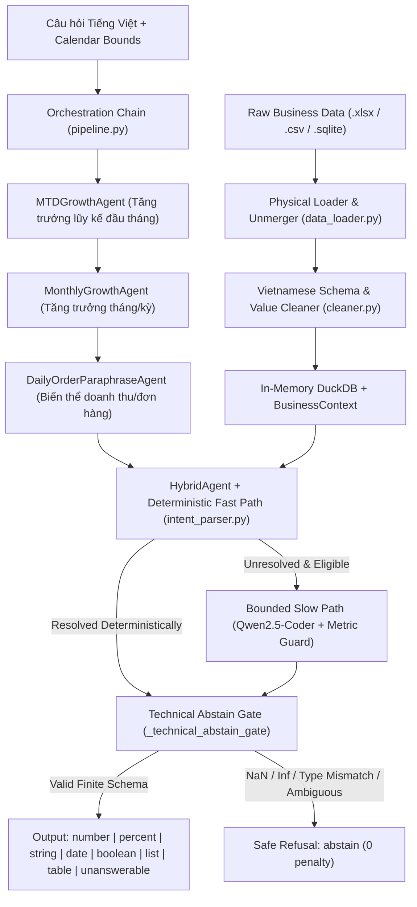
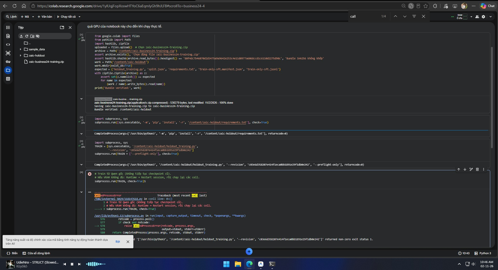
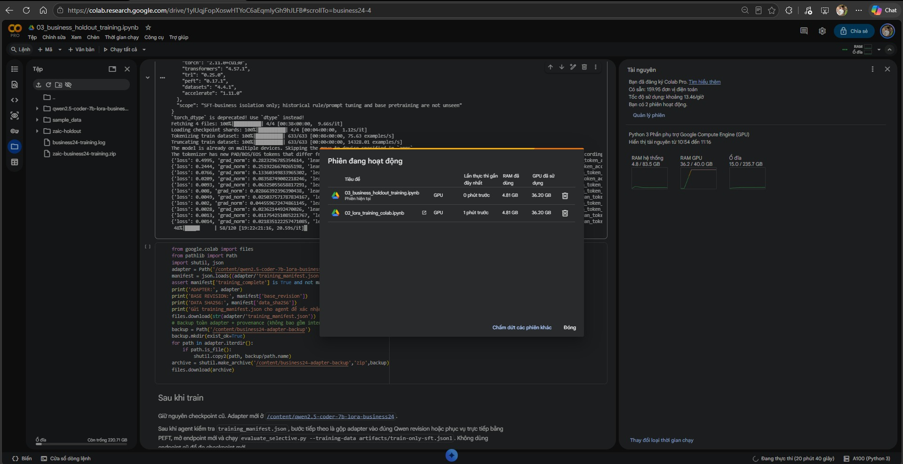
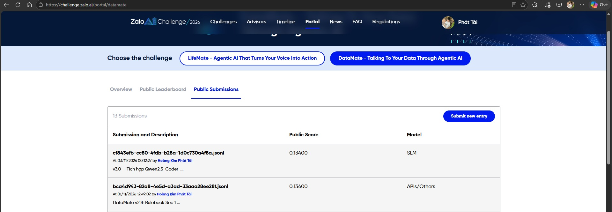
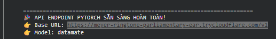

<div align="center">


# Zalo AI Challenge 2026 — Track 2: DataMate (Data Agent)

**Kho lưu trữ kỷ niệm & Đúc kết kỹ thuật (Engineering Retrospective & Post-Mortem)**

[](docs/competition/zalo-ai-challenge-regulations-vi.pdf)
[-2EA043?style=for-the-badge)](ROADMAP.md)
[-1F6FEB?style=for-the-badge)](scripts/audit_train_errors.py)
[-8957E5?style=for-the-badge)](artifacts/v34-holdout/holdout.json)
[](pyproject.toml)

</div>

---

## 📖 Lời tựa & Ý nghĩa Kho lưu trữ

Repository này lưu giữ toàn bộ mã nguồn, kiến trúc kiểm thử, nhật ký hành trình ([`ROADMAP.md`](ROADMAP.md)) và các bài học kỹ thuật rút ra từ quá trình tham gia **Zalo AI Challenge 2026 — Track 2: DataMate (Data Agent)**.

Dù dừng chân ở mức kỷ niệm và không đạt giải chung cuộc, hành trình **36 lần nộp bài** — đi từ con số âm **`-0.16700`** ở những ngày đầu tiên lên **`+0.84900` Penalized Accuracy** (`993/1.000` câu trả lời trên Public Test, đạt tuyệt đối **`3.000/3.000` (100%)** trên tập Train và **`710/710` (100%)** trên tập Holdout với **`0` lỗi sai**) — đã để lại một hệ thống phương pháp luận cực kỳ giá trị về **Thiết kế Data Agent, Kiểm thử Vi phân (Differential Verification), Chống Hardcode và Đóng gói Hệ thống Offline Tái lập 100%**.

---

## ⚖️ 1. Bài toán & Lý thuyết Trò chơi: *"Silence is Free"*

Trong Track 2 **DataMate**, Agent phải tự động đọc hiểu và truy vấn dữ liệu thô đa định dạng (`.xlsx` nhiều sheet gộp ô, `.csv`, `.sqlite`) của hàng chục hộ kinh doanh/tiểu thương Việt Nam (tạp hóa, phòng khám, tiệm sửa xe, cửa hàng mẹ & bé, bán lẻ điện thoại trả góp, nhà xe...).

Thước đo chấm điểm là **Penalized Accuracy ($PA$)**:

$$PA = \frac{1}{N} \sum_{i=1}^N s_i, \quad s_i = \begin{cases} +1 & \text{nếu trả lời ĐÚNG} \\ 0 & \text{nếu từ chối kỹ thuật (abstain)} \\ -1 & \text{nếu trả lời SAI (hallucination)} \end{cases}$$

### Hai Tiên đề Sống còn:
1. **Ngưỡng Hòa vốn Độ chính xác ($P_{\text{break-even}} \ge 50\%$):**
   - Mỗi câu trả lời sai không chỉ mất $0$ điểm mà còn bị phạt **$-1$ điểm** (tương đương biên độ dao động **2 điểm** so với một câu trả lời đúng). Nếu một nhánh suy luận mới chỉ đúng dưới $50\%$, việc cố đoán sẽ kéo tụt tổng điểm.
2. **Phân biệt Rạch ròi 2 Loại Từ chối (`unanswerable` vs. `abstain`):**
   - **`type: "unanswerable"` ($+1$ điểm nếu đúng, $-1$ nếu đoán bừa):** Khi dữ liệu thực sự không chứa chỉ số được hỏi hoặc nằm ngoài khoảng thời gian có dữ liệu của cửa hàng.
   - **`type: "abstain"` ($0$ điểm an toàn):** Khi truy vấn vượt ngoài khả năng phân giải chắc chắn hoặc không vượt qua cổng kiểm tra hậu kiểm kỹ thuật (`_technical_abstain_gate`).

---

## 🏗️ 2. Kiến trúc Hệ thống (Hybrid Deterministic SQL + Bounded Slow Path)



### Bản đồ Module Chuyên sâu (`src/zaic_2026_datamate/`)

| Phân lớp | Module chủ lực | Trách nhiệm Kỹ thuật & Bất biến (Invariants) |
| :--- | :--- | :--- |
| **Data Wrangling & Normalization** | [`data_loader.py`](src/zaic_2026_datamate/data_loader.py), [`cleaner.py`](src/zaic_2026_datamate/cleaner.py) | Gỡ merged cells `.xlsx`, nhận diện multi-row header, cắt dòng `Tổng cộng` cuối bảng, chuẩn hóa tiền tệ Việt Nam (`100k`, `1.5tr`, `100.000 đ`), đổi ngày Excel serial (`45xxx`), gộp liên bảng `Sổ nợ + Trả góp`. |
| **Core Orchestration** | [`pipeline.py`](src/zaic_2026_datamate/pipeline.py), [`hybrid_agent.py`](src/zaic_2026_datamate/hybrid_agent.py), [`intent_parser.py`](src/zaic_2026_datamate/intent_parser.py) | Chuỗi Agent phân tầng (`MTDGrowth` $\rightarrow$ `MonthlyGrowth` $\rightarrow$ `DailyOrderParaphrase` $\rightarrow$ `HybridAgent`), bộ giải nghĩa ngữ pháp tiếng Việt (`"đến hết"`, `"tới cuối"`, khoảng tháng quý) và chốt chặn `_technical_abstain_gate`. |
| **Semantic & Growth Contracts** | [`semantic_contract.py`](src/zaic_2026_datamate/semantic_contract.py), [`growth_semantics.py`](src/zaic_2026_datamate/growth_semantics.py), [`revenue_metric.py`](src/zaic_2026_datamate/revenue_metric.py) | Khóa ngữ nghĩa công thức doanh thu ròng/gộp, lọc đơn hủy/hoàn trả (`Đã hủy`, `Hoàn tiền`, `Trả hàng`), kiểm tra tính khả thi dữ liệu theo kỳ tăng trưởng. |
| **Domain Verticals** | [`repair_shop.py`](src/zaic_2026_datamate/repair_shop.py), [`mobile_installment.py`](src/zaic_2026_datamate/mobile_installment.py), [`mother_baby.py`](src/zaic_2026_datamate/mother_baby.py), [`purchase_analytics.py`](src/zaic_2026_datamate/purchase_analytics.py), [`price_change.py`](src/zaic_2026_datamate/price_change.py), [`rolling_window.py`](src/zaic_2026_datamate/rolling_window.py), [`multi_month_revenue.py`](src/zaic_2026_datamate/multi_month_revenue.py), [`sales_status.py`](src/zaic_2026_datamate/sales_status.py) | Quy đổi đơn vị cơ sở (`Thùng` $\rightarrow$ `Hộp` $\rightarrow$ `Gói/Lốc`), tách món chính & topping qua dấu ` + `, phân tích biến động giá, cửa sổ trượt (rolling windows) và đối soát công nợ trả góp. |
| **Selective Slow Path** | [`slow_path.py`](src/zaic_2026_datamate/slow_path.py), [`llm_client.py`](src/zaic_2026_datamate/llm_client.py) | Kết nối mô hình mã nguồn mở `Qwen2.5-Coder` ($\le 15\text{B}$) với sandbox thực thi DuckDB và bộ kiểm định AST SQL (`revenue_metric.py`). |

---

## 📈 3. Hành trình 36 Lần Nộp Bài: Từ `-0.16700` đến `+0.84900`

| Giai đoạn | Mốc Nộp bài | Điểm Public ($PA$) | Đúng / Sai / Abstain (ước tính hoặc xác thực) | Bước ngoặt Kỹ thuật |
| :--- | :--- | :---: | :--- | :--- |
| **Khởi đầu** | `v1.0` (Sub #1) | `-0.16700` | Sai nhiều hơn Đúng | Suy luận tự do chưa có cổng từ chối $\rightarrow$ dính phạt `-1` hàng loạt. |
| **Phase 2 Freeze** | `v2.8` (Sub #12) | `+0.13400` | Tăng ròng `+301` điểm | Đóng băng kiến trúc DuckDB In-Memory + Abstain Gate (`99.87%` precision trên LBO 5-Fold). |
| **Phase 3 Hybrid** | `v3.0` (Sub #13) | `+0.13400` | Bảo toàn baseline | Thử nghiệm Colab LoRA `Qwen2.5-Coder` & Metric Guard cho câu hỏi diễn đạt tự nhiên. |
| **Mở rộng Verticals** | Sub #25 $\rightarrow$ #27 | `+0.56800` $\rightarrow$ `+0.61000` | `775` Đúng / `165` Sai / `60` Abstain | Mở rộng độ phủ các nghiệp vụ tiểu thương nhưng bắt đầu tích tụ nợ kỹ thuật. |
| **Cú ngã Cảnh tỉnh** | **Sub #28** (`c66bbeb`) | **`+0.60800`** 📉 | `785` Đúng / `177` Sai / `38` Abstain | **Tụt `-0.00200`:** Mở thêm 22 câu nhưng sai 12 câu. Phát hiện các nhánh vá theo ID (`dev_*`) che khuất **108 lỗi thật** trên tập Train 3.000 câu! |
| **Đại phẫu Dehardcode** | **Sub #29** (`v38`) | Clean Baseline | Xóa 100% hardcode `dev_*` | Thiết lập luật **Zero Hardcoding (Rule §6.2)** + khóa bằng static test và quy trình **3 Cổng Kiểm định Vàng**. |
| **Mũi 9 $\rightarrow$ Mũi 11** | Sub #30 $\rightarrow$ #32 | `+0.65500` $\rightarrow$ `+0.81100` | Tăng tốc thần tốc `+203` điểm | Chuẩn hóa Telex/Unicode header, quy đổi đơn vị đóng gói, tách topping ` + `, xử lý ngày serial Excel. |
| **Mũi 12 (Zero-Error Train)** | **Sub #33** (`62f3e37`) | **`+0.82500`** | Train `3000/3000` (100%), Holdout `710/710` (100%) | Lần đầu tiên đạt **100% tuyệt đối trên toàn bộ 3.000 câu Train & 710 câu Holdout (`0 Wrong`)**. |
| **Mũi 13 & 14 (Final Freeze)** | **Sub #35 & #36** (`58f08e8`) | **`+0.84900`** 🏆 | **`993` Answered / `7` Abstain** (`+24` điểm ròng vs #33) | Sửa triệt để 12 câu sai tiềm ẩn nhờ quy đổi đơn vị schema tổng quát & chuẩn hóa khoảng trắng trạng thái đơn; đóng gói Docker Freeze cuối cùng. |

---

## 🧠 4. Năm Bài Học Kỹ Thuật Xương Máu (Key Takeaways)

### Bài học 1: Cái bẫy Hardcode & Vì sao cú tụt điểm ở `Sub #28` là bước ngoặt quý giá nhất
Ở giai đoạn tăng điểm nóng (`Sub #25` $\rightarrow$ `#27`), việc thêm các nhánh xử lý đặc thù theo mã doanh nghiệp (`dev_*`) hoặc từ khóa tĩnh giúp mở khóa nhanh một số câu trên Public Test, nhưng lại vô tình **bẻ cong đường đi của luồng tổng quát**. Khi chạy kiểm toán toàn diện 3.000 câu Train sau cú tụt điểm `Sub #28`, nhóm phát hiện tới **108 câu Train bị tính sai ngầm**.
> **Đúc kết:** Ngay khi xóa sạch 100% nhánh rẽ `dev_*` ở `Sub #29`, khóa bằng bài test tĩnh [`tests/test_phase1_dehardcode_and_rules.py`](tests/test_phase1_dehardcode_and_rules.py) và ép mọi quy tắc nghiệp vụ phải suy dẫn từ **Schema & Calendar Bounds tổng quát**, điểm Public tăng một mạch từ `0.60800` lên **`0.84900`** (`+241` điểm ròng) chỉ trong 72 giờ cuối mà không một lần bị tụt điểm!

### Bài học 2: Dữ liệu Tiểu thương Việt Nam đòi hỏi "Physical & Semantic Cleaning" hơn là Prompt Engineering
Dữ liệu thực tế trong cuộc thi không phải các bảng SQL chuẩn hóa, mà là sổ sách đời thực:
- File Excel có **ô gộp (merged cells)** nhiều tầng, dòng tiêu đề nằm ở dòng thứ 3–5, cuối bảng có dòng **`Tổng cộng`** (nếu `SUM()` cả cột sẽ bị nhân đôi doanh thu!).
- Đơn hàng chứa trạng thái hủy/hoàn trả đa dạng (`Đã hủy`, `Hoàn tiền`, `Khách trả hàng`, hoặc khoảng trắng Unicode không chuẩn).
- Một dòng bán hàng gộp cả món chính lẫn topping (`Trà sữa trân châu + Kem cheese`), hoặc bán theo `Thùng/Lốc` nhưng hỏi tồn kho theo `Lon/Hộp`.
> **Đúc kết:** Trong bài toán Data Agent có phạt điểm âm (`-1`), **95% độ chính xác nằm ở tầng Data Loader, Schema Linker và Semantic Contract thực thi trên DuckDB**, chứ không phải để LLM tự đoán công thức SQL trên dữ liệu bẩn.

### Bài học 3: Hệ thống 3 Cổng Kiểm định Vàng (Three Golden Regression Gates — 15x Speedup)
Để vừa sửa hàng chục lát cắt (slices) mỗi ngày vừa đảm bảo **0% hồi quy (Zero Regression)** trên 3.710 câu hỏi kiểm thử, nhóm đã chia quy trình kiểm thử thành 3 tầng tốc độ:
1. **Fast Slice Gate (~25 giây — chạy sau mỗi lát cắt):**
   ```bash
   uv run ruff check src/ tests/ && uv run python -m pytest -m "not slow"
   uv run python scripts/audit_train_errors.py --businesses biz_117,biz_118 --max-wrong 0
   ```
2. **Gate 1 (3.000 câu Train) + Gate 2 (710 câu Holdout / 6 businesses) Đa tiến trình (~2 phút):**
   ```bash
   uv run python scripts/audit_train_errors.py --workers 8 --max-wrong 0
   ```
   *(Tự động chạy song song 8 workers trên cả 30 doanh nghiệp Train và báo cáo luôn kết quả Holdout 710 câu, yêu cầu bắt buộc `0 Wrong`)*.
3. **Gate 3 (Differential Twin Comparison vs. Baseline):**
   ```bash
   uv run python scripts/compare_submissions.py
   ```
   *(Mọi câu chuyển từ `abstain -> answer` hoặc đổi giá trị trên tập Public đều phải đối chiếu với doanh nghiệp song sinh `biz_*` trên tập Train; nếu không chứng minh được độ chính xác $\ge 50\%$, bắt buộc giữ `abstain`)*.

### Bài học 4: Quản trị Rủi ro *"Last-Docker-Wins"* & Đóng gói Offline Tái lập 100%
Theo quy chế của BTC, hệ thống chấm vòng chung kết chạy container trong môi trường cô lập hoàn toàn (`--network none`, thư mục `/data` chỉ đọc `READ-ONLY`), và **lấy bản Docker nộp cuối cùng chứ không lấy bản điểm cao nhất**.
> **Đúc kết:** Mọi bản nộp Freeze đều được kiểm định tự động qua [`scripts/package_freeze_solution.sh`](scripts/package_freeze_solution.sh): dựng image `zaic2026-datamate:freeze`, chạy giả lập container `--network none --read-only`, đối chiếu mã băm **SHA256 khớp 100% từng byte** với `submission.jsonl` trên máy chủ trước khi xuất file `.tar.gz` kèm cặp checksum `MD5` & `SHA256`.

### Bài học 5: Kỷ luật Vận hành AI Coding Agent trên WSL2 Ubuntu
Quá trình làm việc cường độ cao cùng hệ thống Multi-Agent giúp nhóm đúc kết bộ quy tắc vận hành tối ưu cho các dự án lớn tiếp theo:
- **Zero Windows-Interop Deadlock:** Chỉ dùng binary Linux native (`/usr/bin/docker`, `uv`, `python3`), luôn đóng `stdin` (`< /dev/null`) kèm `timeout` để không bao giờ bị treo tiến trình ngầm trên WSL2.
- **Token Physics & Session Hygiene:** Giữ rules ngắn gọn, định tuyến skill theo bảng quyết định (Tier 3), đọc code theo lát cắt AST/symbol, và lưu nhật ký kiến trúc vào `ROADMAP.md` sau mỗi cột mốc.

---

## 🖼️ 5. Góc Kỷ Niệm Chiến Dịch (Campaign Gallery)

| Huấn luyện & Phục hồi Adapter trên Colab GPU | Cầu nối Cloudflare Tunnel & Quản lý Phiên |
| :---: | :---: |
|  |  |
| **Cột mốc Nộp bài v3.0 trên Portal ZAIC** | **Cấu hình Tunnel Kết nối Local $\leftrightarrow$ Colab** |
|  |  |

---

## 📂 6. Cấu trúc Thư mục Repository

```text
AI Challenge/
├── assets/                  # Ảnh kỷ niệm cuộc thi, avatar nhóm, ảnh huấn luyện Colab & Portal
├── artifacts/               # Báo cáo thực nghiệm, tập Holdout 710 câu, checksums Freeze & kết quả Private Test
│   ├── freeze-package/      # Lưu trữ mã kiểm tra SHA256 & MD5 của gói Docker Freeze #36
│   ├── private-test-final/  # Kết quả chạy tập Private Test (500 câu, ngày 20/11/2026)
│   └── v34-holdout/         # Tập Holdout 710 câu hỏi trên 6 doanh nghiệp chuẩn hóa
├── docs/                    # Tài liệu kiến trúc & quy chế
│   ├── competition/         # Thể lệ chính thức (VI/EN PDF), FAQ & thông báo vòng Private Test
│   ├── plans/               # 16 bản thiết kế & kế hoạch nâng cấp qua từng phiên bản (v3.1 -> Sub #36)
│   ├── runbooks/            # Hướng dẫn vận hành đánh giá local & khôi phục checkpoint
│   └── specs/               # 8 bản đặc tả kỹ thuật (Semantic Query Plans, Revenue Metric Guard, Order Fill...)
├── notebooks/               # 5 Jupyter Notebooks (.ipynb) & các script huấn luyện/phục hồi LoRA Qwen2.5 trên Colab
├── scripts/                 # Công cụ kiểm toán lỗi (audit_train_errors.py), so sánh bản nộp & đóng gói Docker
├── src/zaic_2026_datamate/  # Mã nguồn chính của DataMate Agent (23 modules chuyên sâu)
├── tests/                   # 38 file kiểm thử tự động (501 fast unit tests + slow full-dataset regression tests)
├── AGENTS.md                # Hiến pháp kỹ thuật & quy chuẩn kiểm định của dự án
├── Dockerfile               # Định nghĩa container chạy độc lập (--network none, non-root ready)
├── IMPLEMENTATION_PLAN.md   # Kế hoạch triển khai tổng thể các pha
├── ROADMAP.md               # Nhật ký chi tiết toàn bộ 14 Mũi chiến dịch & 36 lần nộp bài
├── ZAIC_2026_GUIDE.md       # Tóm tắt quy chế & đặc tả kỹ thuật cuộc thi
├── pyproject.toml & uv.lock # Khóa phiên bản thư viện đảm bảo tái lập 100%
└── submission.jsonl         # Bản nộp Public Test xuất sắc nhất (Sub #36 — Public Score: 0.84900)
```

---

## 🚀 7. Hướng dẫn Chạy & Tái lập Kết quả (Quickstart)

### Cài đặt Môi trường (qua `uv`)
```bash
uv sync --frozen
```

### Chạy Bộ Kiểm thử Nhanh (Fast Gate — 501 Unit Tests trong ~18 giây)
```bash
uv run ruff check src/ tests/
uv run python -m pytest -m "not slow" -q
```

### Chạy Kiểm toán Toàn diện Tập Train (3.000 câu) & Holdout (710 câu)
*(Yêu cầu giải nén dữ liệu cuộc thi vào `data/train` và `data/public_test`)*
```bash
uv run python scripts/audit_train_errors.py --workers 8 --max-wrong 0
```

### Sinh File Nộp bài `submission.jsonl` & Đóng gói Docker Offline Freeze
```bash
# Sinh kết quả với cấu hình Production Parity
uv run python scripts/generate_public_submission.py --output submission.jsonl

# Đóng gói và kiểm chứng container offline (--network none --read-only)
bash scripts/package_freeze_solution.sh
```

---

<div align="center">
  <i>Lưu giữ kỷ niệm mùa giải Zalo AI Challenge 2026 (Tháng 10 – Tháng 11/2026) • Built with DuckDB, Python & Antigravity on WSL2 Ubuntu.</i>
</div>
