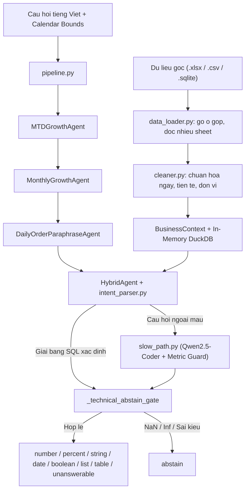
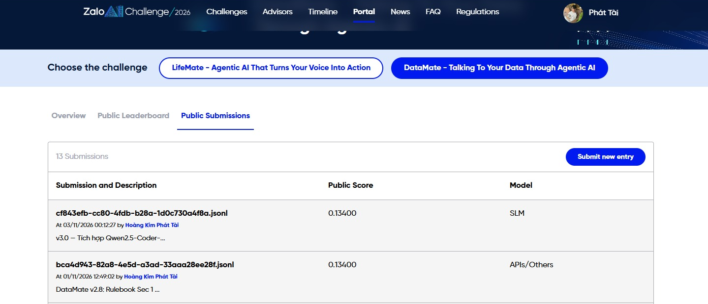

<p align="center">
  
</p>

# Zalo AI Challenge 2026: Track 2 DataMate

Kho lưu trữ mã nguồn, kết quả thực nghiệm và ghi chép kỹ thuật từ mùa giải Zalo AI Challenge 2026 (Track 2: DataMate, tháng 10 đến tháng 11 năm 2026).

Mình không có giải ở vòng chung kết. Repo này giữ lại mã nguồn, nhật ký 36 lần nộp bài trong [`ROADMAP.md`](ROADMAP.md) và những lỗi sai đáng nhớ trong quá trình xây dựng Data Agent.

Kết quả cao nhất trên Public Leaderboard đạt `0.84900` Penalized Accuracy ở Sub #35 và Sub #36 (`993` câu trả lời, `7` câu `abstain`). Bộ kiểm thử nội bộ ở bản chốt cuối đạt `3.000/3.000` câu tập Train và `710/710` câu tập Holdout (6 doanh nghiệp), sai `0` câu.

---

## 1. Thước đo điểm số

Bài toán yêu cầu truy vấn dữ liệu thô (`.xlsx`, `.csv`, `.sqlite`) của nhiều cửa hàng Việt Nam như tạp hóa, phòng khám, tiệm sửa xe, cửa hàng mẹ và bé, cửa hàng điện thoại trả góp.

Hệ thống chấm điểm dùng Penalized Accuracy ($PA$):

$$PA = \frac{1}{N} \sum_{i=1}^N s_i, \quad s_i = \begin{cases} +1 & \text{trả lời đúng} \\ 0 & \text{abstain} \\ -1 & \text{trả lời sai} \end{cases}$$

Mỗi câu sai trừ 1 điểm, tức lệch 2 điểm so với một câu đúng. Mọi nhánh xử lý mới đều phải có xác suất đúng tối thiểu 50% mới mang lại điểm dương.

Ngoài ra, bài toán tách rõ hai trạng thái từ chối:

- `unanswerable`: dữ liệu thiếu cột chỉ số được hỏi hoặc câu hỏi rơi ra ngoài khoảng ngày có dữ liệu. Trả về đúng loại này được `+1` điểm; đoán một con số sẽ bị `-1`.
- `abstain`: truy vấn gặp lỗi kỹ thuật hoặc dữ liệu nhập nhằng không đủ căn cứ. Trả về `abstain` nhận `0` điểm để tránh mất điểm.

---

## 2. Kiến trúc hệ thống

Hệ thống chạy theo mô hình lai: tầng xử lý dữ liệu xác định trên DuckDB đảm nhiệm phần lớn câu hỏi, còn mô hình ngôn ngữ (`Qwen2.5-Coder` dưới 15B tham số) chỉ tham gia vào nhóm câu hỏi diễn đạt tự nhiên có kiểm soát đầu ra.



### Các module chính trong `src/zaic_2026_datamate/`

| Nhóm chức năng | File mã nguồn | Nhiệm vụ |
| :--- | :--- | :--- |
| Đọc và làm sạch dữ liệu | [`data_loader.py`](src/zaic_2026_datamate/data_loader.py), [`cleaner.py`](src/zaic_2026_datamate/cleaner.py) | Gỡ ô gộp Excel, dò tiêu đề nhiều dòng, cắt dòng `Tổng cộng` cuối bảng, đổi tiền tệ Việt Nam (`100k`, `1.5tr`, `100.000 đ`), đổi số serial ngày Excel (`45xxx`), nối sổ nợ và trả góp. |
| Điều phối và giải nghĩa | [`pipeline.py`](src/zaic_2026_datamate/pipeline.py), [`hybrid_agent.py`](src/zaic_2026_datamate/hybrid_agent.py), [`intent_parser.py`](src/zaic_2026_datamate/intent_parser.py) | Ghép chuỗi wrapper theo thứ tự ưu tiên, phân tách ngữ pháp thời gian tiếng Việt (`đến hết`, `tới cuối`, quý, tháng), ép giá trị `NaN`/`Inf` hoặc sai kiểu về `abstain`. |
| Khóa ngữ nghĩa doanh thu | [`semantic_contract.py`](src/zaic_2026_datamate/semantic_contract.py), [`growth_semantics.py`](src/zaic_2026_datamate/growth_semantics.py), [`revenue_metric.py`](src/zaic_2026_datamate/revenue_metric.py) | Loại bỏ đơn hủy và đơn hoàn tiền (`Đã hủy`, `Hoàn tiền`, `Trả hàng`), kiểm tra điều kiện đủ dữ liệu cho câu hỏi tăng trưởng kỳ trước và MTD. |
| Nghiệp vụ theo ngành hàng | [`repair_shop.py`](src/zaic_2026_datamate/repair_shop.py), [`mobile_installment.py`](src/zaic_2026_datamate/mobile_installment.py), [`mother_baby.py`](src/zaic_2026_datamate/mother_baby.py), [`purchase_analytics.py`](src/zaic_2026_datamate/purchase_analytics.py), [`price_change.py`](src/zaic_2026_datamate/price_change.py), [`rolling_window.py`](src/zaic_2026_datamate/rolling_window.py), [`multi_month_revenue.py`](src/zaic_2026_datamate/multi_month_revenue.py), [`sales_status.py`](src/zaic_2026_datamate/sales_status.py) | Quy đổi đơn vị đóng gói (`Thùng`, `Lốc`, `Hộp`, `Lon`), tách món chính và topping qua dấu ` + `, tính biến động giá, cửa sổ trượt và công nợ trả góp. |
| Slow Path (LLM) | [`slow_path.py`](src/zaic_2026_datamate/slow_path.py), [`llm_client.py`](src/zaic_2026_datamate/llm_client.py) | Gọi endpoint tương thích OpenAI cho `Qwen2.5-Coder`, kiểm tra AST câu SQL trước khi chạy trên DuckDB. |

---

## 3. Diễn biến điểm số qua 36 lần nộp

| Mốc | Commit / Bản nộp | Public Score | Ghi chú kỹ thuật |
| :--- | :--- | :---: | :--- |
| Khởi đầu | `v1.0` (Sub #1) | `-0.16700` | Chưa có cổng `abstain`, nhiều câu sai kéo điểm xuống âm. |
| Phase 2 | `v2.8` (Sub #12) | `+0.13400` | Chuyển sang DuckDB xác định kết hợp cổng từ chối, đạt `99.87%` precision trên kiểm thử LBO 5-Fold. |
| Phase 3 | `v3.0` (Sub #13) | `+0.13400` | Thử nghiệm fine-tune LoRA `Qwen2.5-Coder` trên Colab và nối cổng kiểm tra công thức doanh thu. |
| Mở rộng ngành hàng | Sub #25 đến #27 | `+0.56800` -> `+0.61000` | Sub #27 đạt `775` đúng, `165` sai, `60` `abstain`. |
| Sụt điểm | Sub #28 (`c66bbeb`) | `+0.60800` | Trả lời thêm 22 câu nhưng sai 12 câu, mất ròng 2 điểm. Rà soát 3.000 câu Train phát hiện 108 lỗi bị che khuất do nhánh hardcode `dev_*`. |
| Xóa hardcode | Sub #29 (`v38`) | Clean baseline | Gỡ bỏ toàn bộ rẽ nhánh theo `business_id`, thêm test tĩnh cấm hardcode và dựng quy trình kiểm tra 3 cổng. |
| Mũi 9 đến Mũi 11 | Sub #30 đến #32 | `+0.65500` -> `+0.81100` | Chuẩn hóa tên cột Telex/Unicode, quy đổi đơn vị đóng gói, tách topping ` + `, xử lý ngày serial Excel. |
| Mũi 12 | Sub #33 (`62f3e37`) | `+0.82500` | Đạt `3.000/3.000` câu Train và `710/710` câu Holdout, sai `0` câu. |
| Mũi 13 và 14 | Sub #35 và #36 (`58f08e8`) | `+0.84900` | Sửa 12 câu sai tiềm ẩn qua chuẩn hóa khoảng trắng trạng thái đơn và quy đổi đơn vị theo schema; đóng gói Docker Freeze cuối cùng. |

<p align="center">
  
</p>

*Ảnh chụp cổng nộp bài giai đoạn đầu (Sub #12 `v2.8` và Sub #13 `v3.0` tại mốc `0.13400`, trước khi xóa nhánh hardcode và nâng điểm ở các mũi cuối).*

---

## 4. Các bài học rút ra sau cuộc thi

### 1. Rẽ nhánh theo ID tập test làm hỏng hệ thống kiểm chứng
Từ Sub #25 đến Sub #28, mình thêm nhiều nhánh xử lý riêng cho một vài cửa hàng `dev_*` trên tập Public để lấy điểm nhanh. Cách làm này che mờ lỗi gốc của bộ phân tích chung. Khi chạy lại 3.000 câu tập Train sau đợt tụt điểm ở Sub #28 (`0.60800`), script kiểm toán chỉ ra 108 câu đang tính sai.

Mình xóa các nhánh rẽ `dev_*` ở Sub #29, khóa quy định này bằng test tĩnh trong [`tests/test_phase1_dehardcode_and_rules.py`](tests/test_phase1_dehardcode_and_rules.py) và viết lại logic dựa trên cấu trúc bảng cùng biên lịch chung. Qua 7 lần nộp sau đó, điểm Public tăng từ `0.60800` lên `0.84900`.

### 2. Tiền xử lý bảng tính quyết định phần lớn độ chính xác
Dữ liệu tiểu thương Việt Nam chứa nhiều bẫy ở tầng định dạng vật lý:
- File `.xlsx` gộp nhiều ô ở tiêu đề và chèn dòng `Tổng cộng` ngay cuối bảng. Nếu chạy `SUM()` trực tiếp sẽ nhân đôi doanh thu.
- Cột trạng thái đơn hàng dùng nhiều cách ghi khác nhau kèm khoảng trắng thừa (`Đã hủy`, `Hoàn tiền`, `Khách trả hàng`).
- Một dòng bán hàng gộp tên món và topping bằng dấu ` + `, hoặc bán theo `Thùng`/`Lốc` nhưng câu hỏi yêu cầu tính theo `Hộp`/`Lon`.

Khi xử lý các lớp nhiễu này ngay tại `data_loader.py` và `cleaner.py`, câu SQL phía sau ngắn gọn và dễ viết unit test hơn việc đẩy bảng thô vào prompt cho LLM.

### 3. Phân tầng kiểm thử để giữ tốc độ sửa lỗi
Chạy lại 3.000 câu Train sau mỗi lần sửa code mất nhiều phút và làm đứt mạch làm việc. Mình chia bộ kiểm tra thành 3 tầng theo thời gian chạy:

1. **Fast Gate (~20 giây):** chạy `ruff check`, `pytest -m "not slow"` (501 unit tests) và kiểm tra đúng 1 đến 2 doanh nghiệp liên quan đến lát cắt vừa sửa.
2. **Gate 1 + Gate 2 song song (~2 phút):** chạy `scripts/audit_train_errors.py --workers 8 --max-wrong 0` trên cả 30 doanh nghiệp Train (3.000 câu) và tự động đối chiếu tập Holdout (710 câu).
3. **Gate 3 (Differential Diff):** chạy `scripts/compare_submissions.py` để soi từng câu chuyển từ `abstain` sang có đáp án hoặc đổi giá trị so với bản nộp trước đó. Câu nào không chứng minh được trên dữ liệu song sinh ở tập Train sẽ giữ ở `abstain`.

### 4. Kiểm thử tái lập trong môi trường container cô lập
Theo thể lệ, hệ thống chấm vòng chung kết chạy Docker container ở chế độ không có mạng (`--network none`), gắn thư mục `/data` chỉ đọc và lấy bản Docker nộp cuối cùng làm kết quả chính thức.

Trước khi nộp bản Freeze #36, script [`scripts/package_freeze_solution.sh`](scripts/package_freeze_solution.sh) dựng image `zaic2026-datamate:freeze`, chạy container với cờ `--network none --read-only` trong `277.93s` và đối chiếu SHA256 của file `submission.jsonl` sinh ra bên trong container khớp từng byte (`76b33a45349f183aac8c778b19c3f95966b90fd2af12e7badf4c0f60c33b924d`) với bản chạy cục bộ. Script xuất cặp checksum MD5 và SHA256 của gói `.tar.gz` cuối cùng vào [`artifacts/freeze-package/checksums.txt`](artifacts/freeze-package/checksums.txt).

---

## 5. Cấu trúc thư mục

```text
.
├── assets/                  # Logo nhom va anh chup man hinh portal
├── artifacts/               # Cac moc replay, tap Holdout 710 cau, checksums Freeze va ket qua Private Test
│   ├── freeze-package/      # Checksum SHA256 & MD5 cua ban Docker Freeze #36
│   ├── private-test-final/  # Ket qua chay tap Private Test ngay 20/11/2026
│   └── v34-holdout/         # Tap Holdout 710 cau / 6 doanh nghiep
├── docs/                    # Tai lieu kien truc va the le cuoc thi
│   ├── competition/         # The le PDF (VI/EN), FAQ va thong bao vong Private
│   ├── plans/               # 16 ban ke hoach nang cap tu v3.1 den Sub #36
│   ├── runbooks/            # Huong dan danh gia local va phuc hoi checkpoint
│   └── specs/               # 8 ban dac ta ky thuat
├── notebooks/               # Notebook Colab huan luyen va phuc hoi LoRA Qwen2.5
├── scripts/                 # Script audit loi, so sanh ban nop va dong goi Docker
├── src/zaic_2026_datamate/  # Ma nguon chinh cua DataMate Agent
├── tests/                   # 38 file test (501 fast tests + slow regression tests)
├── AGENTS.md                # Quy uoc ky thuat cua repo
├── Dockerfile               # Cau hinh container chay offline (--network none)
├── IMPLEMENTATION_PLAN.md   # Ke hoach trien khai theo giai doan
├── ROADMAP.md               # Nhat ky 14 mui chien dich va 36 lan nop bai
├── ZAIC_2026_GUIDE.md       # Tom tat quy che cuoc thi
├── pyproject.toml & uv.lock # Khoa phien ban thu vien
└── submission.jsonl         # Ban nop Public Test cuoi cung (Sub #36, 0.84900)
```

---

## 6. Hướng dẫn chạy lại cục bộ

### Cài đặt môi trường

```bash
uv sync --frozen
```

### Chạy bộ test nhanh (501 tests)

```bash
uv run ruff check src/ tests/
uv run python -m pytest -m "not slow" -q
```

### Kiểm toán tập Train (3.000 câu) và Holdout (710 câu)

Cần giải nén dữ liệu cuộc thi vào `data/train` và `data/public_test` trước khi chạy:

```bash
uv run python scripts/audit_train_errors.py --workers 8 --max-wrong 0
```

### Sinh `submission.jsonl` và đóng gói Docker offline

```bash
uv run python scripts/generate_public_submission.py --output submission.jsonl
bash scripts/package_freeze_solution.sh
```
